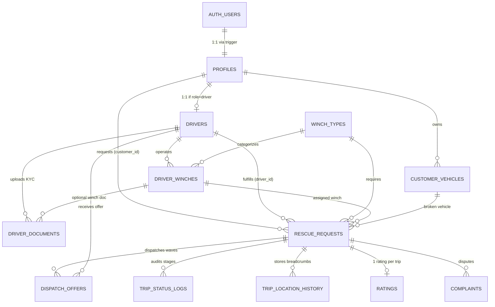
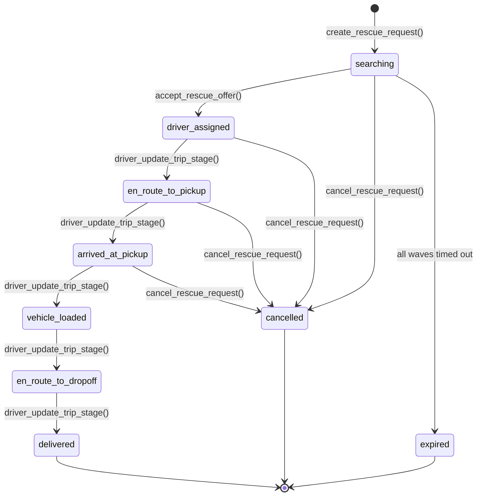

# Wenshy (ونشي) — Backend Architecture, ERD & Flutter Realtime Guide

## 1. Entity Relationship Diagram (ERD)

## 2. Trip Lifecycle State Machine

## 3. Hybrid Realtime Architecture for Flutter (`supabase_flutter`)

### Why Hybrid (Private Broadcast + Database Triggers + Throttled PostGIS Sync)?
1. **High-Frequency Live GPS (2–3s) via Ephemeral Broadcast (`trip:<request_id>`):**
   - Sending GPS coordinates every 2 seconds into PostgreSQL tables creates heavy WAL write amplification and slows down Postgres Changes replication.
   - Instead, the Driver app broadcasts `{ lat, lng, heading, speed }` directly over a **Private Broadcast Channel** (`trip:<request_id>`), authorized via `realtime.messages` RLS so **only the assigned driver** can publish and **only the trip customer, driver, and admins** can subscribe.
2. **Reliable Trip State & Dispatch Notifications via `realtime.broadcast_changes`:**
   - Database triggers on `rescue_requests` and `dispatch_offers` call `realtime.broadcast_changes(...)` to push authoritative committed state changes to `trip:<request_id>` and `driver:<driver_id>`.
3. **Throttled PostGIS Location Sync (`driver_update_location` RPC every 15–30s or 100m):**
   - Keeps `drivers.current_location` (`geography(Point, 4326)`) fresh for PostGIS nearest-driver matching (`ST_DWithin`) and records trip route breadcrumbs in `trip_location_history` without overloading Postgres.
4. **Online Fleet Presence (`fleet:online`):**
   - Tracks real-time WebSocket connectivity of approved online drivers.

### Migration Execution Order
1. `supabase/migrations/20261112212957_extensions_and_types.sql`
2. `supabase/migrations/20261112213011_core_tables_and_indexes.sql`
3. `supabase/migrations/20261112213041_triggers_and_guards.sql`
4. `supabase/migrations/20261112213102_rpc_functions_and_views.sql`
5. `supabase/migrations/20261112213122_rls_and_storage_policies.sql`
6. `supabase/migrations/20261112213735_rpc_execution_privileges.sql`
6. `supabase/seed.sql`
